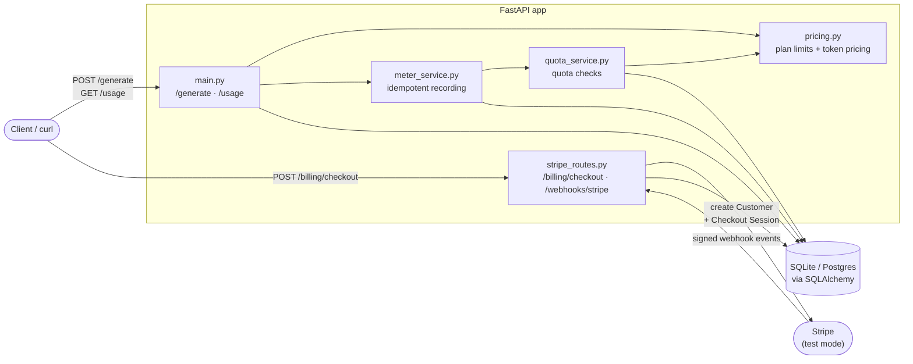
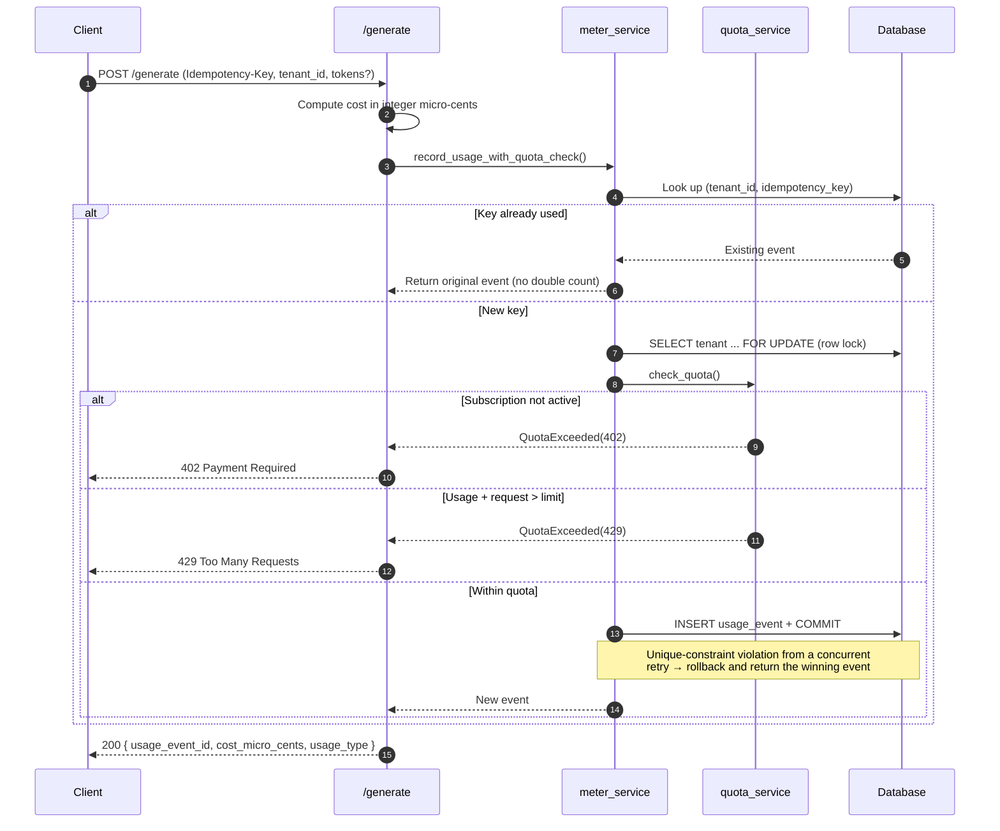
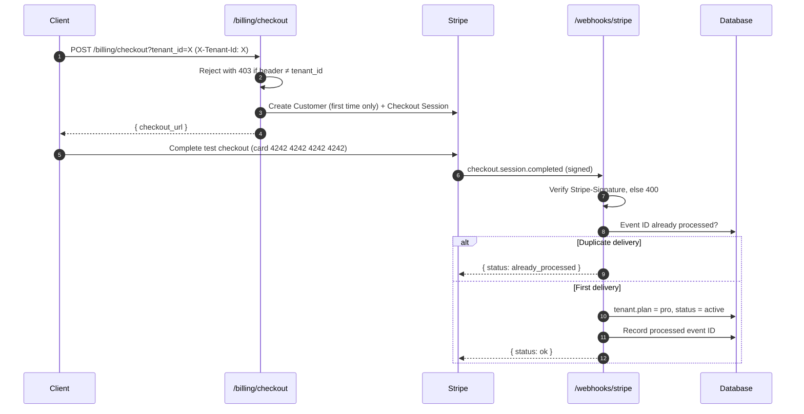
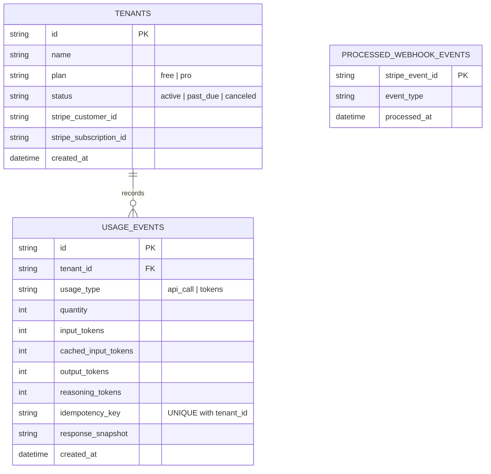

# Usage Metering & Billing Engine


A backend service that answers the three questions every SaaS product has to answer:

1. **How much has this customer used?**
2. **What does it cost?**
3. **Have they hit their limit?**

It meters usage idempotently, enforces per-plan quotas with honest `429` / `402` responses, prices AI token usage with real-world rules (cached input, reasoning tokens, non-additive categories) using integer-only money math, and keeps subscription state in sync with Stripe through signature-verified, deduplicated webhooks.

Built for the **FlyRank Internship – Backend Track** capstone.

---

## Table of Contents

- [Features](#features)
- [Architecture](#architecture)
- [Request Flows](#request-flows)
- [Data Model](#data-model)
- [Plans & Pricing](#plans--pricing)
- [API Reference](#api-reference)
- [Getting Started](#getting-started)
- [Usage Examples](#usage-examples)
- [Testing](#testing)
- [Project Structure](#project-structure)
- [Known Limitations](#known-limitations)
- [Further Reading](#further-reading)

---

## Features

| | Feature | Details |
|---|---|---|
| 🔁 | **Idempotent metering** | Every billable request carries an `Idempotency-Key`. A `(tenant_id, idempotency_key)` unique constraint guarantees a retried request is recorded exactly once and returns the original event. |
| 🚦 | **Quota enforcement** | Checked *before* the billable action. `429 Too Many Requests` when a usage limit would be exceeded; `402 Payment Required` when the subscription itself isn't active. |
| 🔒 | **Race-safe boundary** | The quota check and the usage insert run in a single transaction behind a tenant row lock, closing the check-then-write race at the exact quota boundary. |
| 💰 | **Integer-only money** | All costs are stored and summed as integer micro-cents. Floats never touch a stored or aggregated value, so rounding drift can't accumulate. |
| 🧠 | **Realistic token pricing** | Cached input is billed cheaper than fresh input, reasoning tokens are billed at the output rate, and each category is priced separately rather than summed. |
| 💳 | **Stripe integration** | Subscription Checkout (test mode only — no real money moves). Plan and status are driven purely by verified webhook events, each processed at most once. |

---

## Architecture



**Design principles**

- **The database is the source of truth.** Idempotency, quota state and webhook dedup are all enforced with constraints and transactions, not in-memory state.
- **Stripe drives the plan, not the client.** A tenant only becomes `pro` when a verified `checkout.session.completed` event arrives.
- **Money is an integer until the display boundary.** Conversion to a human-readable string happens only when formatting output.

---

## Request Flows

### Metering a billable action — `POST /generate`



### Subscription sync — Stripe Checkout & webhooks



| Stripe event | Effect on tenant |
|---|---|
| `checkout.session.completed` | `plan → pro`, `status → active`, stores subscription ID |
| `customer.subscription.updated` | `status → active` if Stripe reports active, otherwise `past_due` |
| `customer.subscription.deleted` | `plan → free`, `status → canceled` |

---

## Data Model



---

## Plans & Pricing

### Plan quotas

| Plan | API calls | Tokens |
|---|---:|---:|
| **Free** | 1,000 | 100,000 |
| **Pro** | 50,000 | 5,000,000 |

### Token pricing

Rates are pinned integer constants in [`app/pricing.py`](app/pricing.py), expressed in micro-cents per 1M tokens:

| Category | Rate (micro-cents / 1M tokens) | Relative to fresh input |
|---|---:|---:|
| Fresh input | 1,500,000 | 1× |
| Cached input | 375,000 | 0.25× |
| Output | 6,000,000 | 4× |
| Reasoning | billed as output | 4× |

```python
cost  = input_tokens        * INPUT_RATE        // 1_000_000
cost += cached_input_tokens * CACHED_INPUT_RATE // 1_000_000
cost += (output_tokens + reasoning_tokens) * OUTPUT_RATE // 1_000_000
```

---

## API Reference

Interactive docs are available at **`http://localhost:8000/docs`** (Swagger UI) once the server is running.

| Method | Endpoint | Headers | Description |
|---|---|---|---|
| `POST` | `/generate` | `Idempotency-Key` *(required)* | Record one billable action. Omit `tokens` for a plain API call. |
| `GET` | `/usage?tenant_id=` | — | Usage vs. limits and total token cost for a tenant. |
| `POST` | `/billing/checkout?tenant_id=` | `X-Tenant-Id` *(must match)* | Create a Stripe Checkout session for the Pro plan. |
| `POST` | `/webhooks/stripe` | `Stripe-Signature` | Receive and apply Stripe subscription events. |

<details>
<summary><b>Request & response examples</b></summary>

**`POST /generate`** — token usage

```json
{
  "tenant_id": "a1b2c3...",
  "tokens": {
    "input_tokens": 1200,
    "cached_input_tokens": 800,
    "output_tokens": 300,
    "reasoning_tokens": 150
  }
}
```

```json
{
  "usage_event_id": "e4f5...",
  "cost_micro_cents": 4800,
  "usage_type": "tokens"
}
```

**`GET /usage`**

```json
{
  "tenant_id": "a1b2c3...",
  "plan": "free",
  "api_calls": { "used": 999, "limit": 1000 },
  "tokens":    { "used": 0,   "limit": 100000 },
  "cost_micro_cents": 0
}
```

**Quota exceeded — `429`**

```json
{
  "detail": "Quota exceeded for api_call: 1000/1000 used, requested 1 would exceed the free plan limit."
}
```

</details>

---

## Getting Started

### Prerequisites

- Python 3.10+ (developed on 3.13)
- A free [Stripe](https://dashboard.stripe.com/register) account in **test mode**
- The [Stripe CLI](https://docs.stripe.com/stripe-cli) for forwarding webhooks locally

### Installation

```bash
git clone <this-repo-url>
cd FlyRank-Capstone-Metered-Billing

python -m venv venv
source venv/bin/activate        # Windows: venv\Scripts\activate

pip install -r requirements.txt
cp .env.example .env
```

### Configuration

Fill in `.env` with your own Stripe **test** credentials:

| Variable | Description | Default |
|---|---|---|
| `DATABASE_URL` | SQLAlchemy connection string | `sqlite:///./billing.db` |
| `STRIPE_SECRET_KEY` | Stripe test secret key (`sk_test_…`) | — |
| `STRIPE_WEBHOOK_SECRET` | Webhook signing secret (`whsec_…`), printed by `stripe listen` | — |
| `STRIPE_PRICE_ID_PRO` | Price ID of the Pro subscription (`price_…`) | — |

### Run

```bash
# 1. Start the API
uvicorn app.main:app --reload

# 2. Seed a demo tenant sitting one call away from its quota (prints the tenant ID)
python -m app.seed

# 3. In a second terminal, forward Stripe webhooks — no tunnel or public URL needed
stripe login
stripe listen --forward-to localhost:8000/webhooks/stripe
```

---

## Usage Examples

Replace `<id>` with the tenant ID printed by `python -m app.seed`.

```bash
# Use the last call in the quota → 200
curl -X POST http://localhost:8000/generate \
  -H "Idempotency-Key: k1" -H "Content-Type: application/json" \
  -d '{"tenant_id":"<id>"}'

# Retry with the same key → same event returned, no double count
curl -X POST http://localhost:8000/generate \
  -H "Idempotency-Key: k1" -H "Content-Type: application/json" \
  -d '{"tenant_id":"<id>"}'

# New key, quota exhausted → 429
curl -X POST http://localhost:8000/generate \
  -H "Idempotency-Key: k2" -H "Content-Type: application/json" \
  -d '{"tenant_id":"<id>"}'

# Check the usage rollup
curl "http://localhost:8000/usage?tenant_id=<id>"

# Start a Checkout session — X-Tenant-Id must match the tenant being billed
curl -X POST "http://localhost:8000/billing/checkout?tenant_id=<id>" \
  -H "X-Tenant-Id: <id>"
```

Open the returned `checkout_url`, pay with test card `4242 4242 4242 4242`, and the webhook will upgrade the tenant to `pro`. Replaying an event is safely ignored:

```bash
stripe trigger checkout.session.completed
```

---

## Testing

```bash
pytest -q
```

The suite runs against a fresh in-memory SQLite database per test and covers:

| Area | What's verified |
|---|---|
| Metering | Duplicate idempotency key creates exactly one event |
| Quotas | Call #1,000 is allowed, call #1,001 is rejected with `429` |
| Pricing | Cached input is cheaper than fresh input; reasoning tokens cost the same as output |
| Webhooks | Forged signature → `400`; duplicate delivery processed only once |

---

## Project Structure

```
.
├── app/
│   ├── main.py            # FastAPI app, /generate and /usage
│   ├── stripe_routes.py   # /billing/checkout and /webhooks/stripe
│   ├── meter_service.py   # Idempotent, transactional usage recording
│   ├── quota_service.py   # Usage totals and quota checks (402 / 429)
│   ├── pricing.py         # Plan quotas and integer token pricing
│   ├── models.py          # SQLAlchemy models
│   ├── schemas.py         # Pydantic request models
│   ├── db.py              # Engine, session and init
│   ├── config.py          # Settings loaded from .env
│   ├── exceptions.py      # QuotaExceeded
│   └── seed.py            # Demo tenant at 999/1000 calls
├── tests/
│   ├── conftest.py        # Fixtures: in-memory DB, tenants, signed Stripe payloads
│   └── tests.py
├── capstone.yaml          # Run / seed / test commands and endpoint list
├── requirements.txt
└── .env.example
```

---

## Known Limitations

- **Row locking needs Postgres.** On SQLite, `with_for_update()` is a no-op, so true concurrent-write protection at the quota boundary requires Postgres. SQLite is for local development only.
- **Token counts are simulated.** The service meters and prices the numbers sent to `/generate`; it does not call an LLM.
- **No billing periods.** Quotas are checked against all recorded usage for a tenant; there's no monthly reset yet.
- **No proration, invoicing or overage billing.** These are out of scope for the core and remain stretch goals.
- **Stripe test mode only.** No real payments are processed.

---

## Further Reading

- [`DESIGN.md`](DESIGN.md) — module layout and design notes
- [`DEMO.md`](DEMO.md) — scripted walkthrough of the demo
- [`BUILDLOG.md`](BUILDLOG.md) — how AI was used during the build, and where its suggestions were wrong
